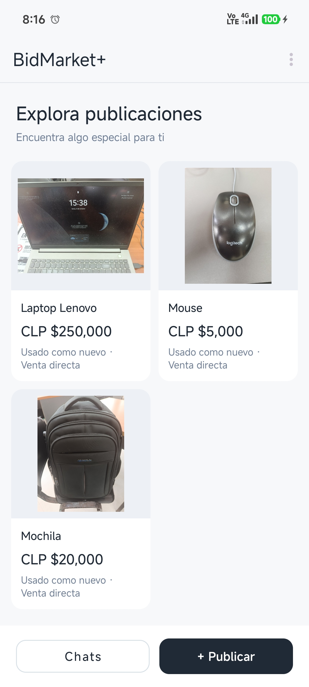
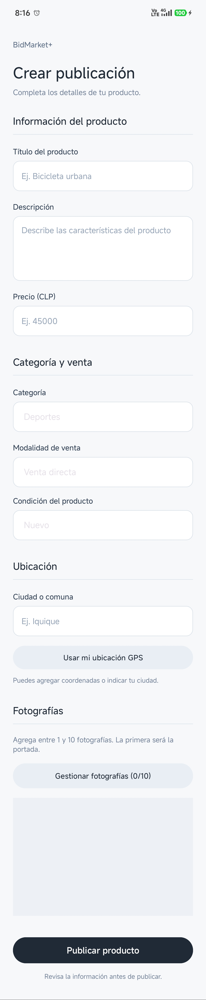
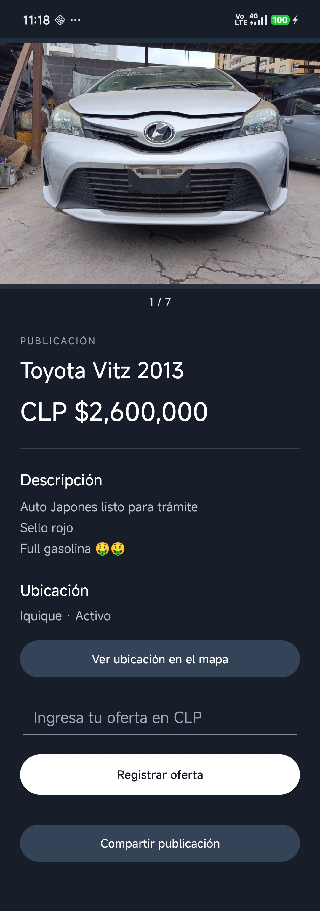
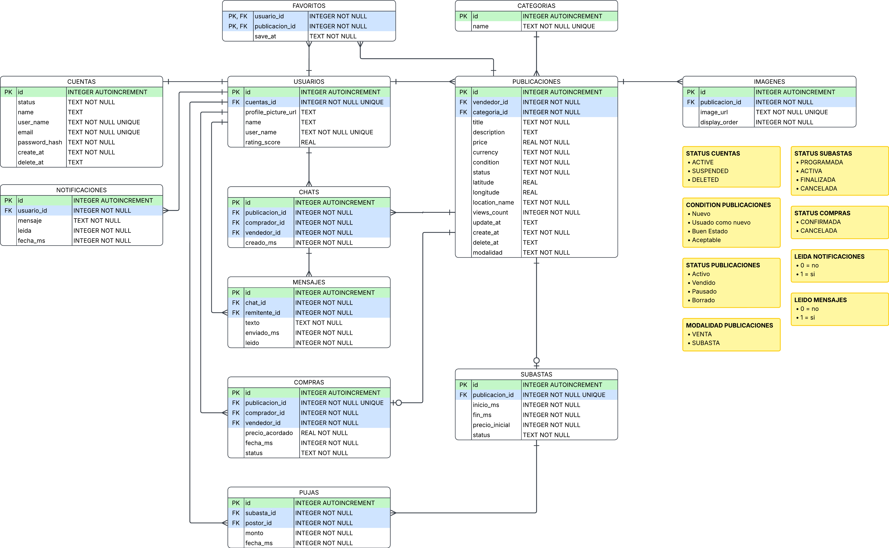

# BidMarket+

BidMarketPlus es una aplicación Android para publicar, comprar y vender productos de dos formas: venta directa a precio fijo y subasta. El objetivo es que el vendedor pueda crear una publicación con fotos y que el comprador pueda elegir entre comprar al precio indicado o hacer una oferta.

## Ficha del proyecto

| Dato | Detalle |
| --- | --- |
| Autor | Walter Valenzuela |
| Asignatura | Programación Android |
| Docente | Leopoldo Rodriguez |
| Institución | Instituto Profesional Santo Tomás, sede Iquique |
| Tipo de proyecto | Aplicación móvil académica |
| Compatibilidad | Android 11 o superior (API 30+) |

## Capturas de la app

La galería está preparada para mostrar el catálogo, el detalle de una publicación y una subasta en curso.

| Catálogo | Detalle de publicación | Subasta |
| :---: | :---: | :---: |
|  |  |  |
| Vista general de los productos activos. | Fotos, precio y datos del producto. | Precio inicial, mayor oferta y formulario de puja. |

## Funciones principales

- **Acceso.** Registro e inicio de sesión con correo y contraseña. También se puede entrar con Google y vincular la cuenta a un perfil local.
- **Publicaciones.** Crear, editar, pausar y retirar publicaciones. Cada una tiene una categoría y entre 1 y 10 fotos tomadas con la cámara o seleccionadas de la galería. La primera foto de la lista se usa como portada.
- **Venta directa.** El comprador puede registrar una compra al precio publicado. La publicación queda marcada como vendida.
- **Subastas.** Los compradores pueden hacer ofertas durante el plazo de la subasta. Una nueva puja debe alcanzar el precio inicial y superar la mayor oferta registrada.
- **Chat y avisos.** El historial guarda conversaciones entre comprador y vendedor. En una subasta, el chat queda disponible después del cierre si la subasta no fue cancelada. Los avisos se consultan dentro de la app.
- **Mapa y sensores.** La publicación puede incluir coordenadas para mostrarlas en Google Maps. La pantalla del mapa también muestra las lecturas del acelerómetro si el dispositivo cuenta con ese sensor.

> **Alcance actual.** Las publicaciones, las compras, las pujas, los chats y los avisos se guardan en SQLite en el dispositivo. El acceso con Google usa Firebase Authentication, pero eso no sincroniza los datos entre teléfonos. La app no procesa pagos ni envía notificaciones push.

## Tecnologías y requisitos

- **Lenguaje y entorno.** Java y Android Studio, con Gradle para la compilación.
- **SDK de Android.** Mínimo API 30 (Android 11). El proyecto está configurado para compilar y apuntar a la API 37.
- **Interfaz.** Diseños en XML con componentes de Material Design. El catálogo usa `RecyclerView` para mostrar las publicaciones en dos columnas.
- **Base de datos local.** SQLite, administrada con `SQLiteOpenHelper` para crear y actualizar el esquema.
- **Autenticación.** Acceso local con correo y contraseña. El acceso con Google usa Credential Manager y Firebase Authentication, y se vincula a un perfil local.
- **Cámara y galería.** `ActivityResultLauncher` gestiona la captura y selección de fotos. `FileProvider` permite compartir con la cámara una URI de contenido en lugar de exponer la ruta del archivo.
- **Mapas y ubicación.** Maps SDK for Android muestra las ubicaciones y Fused Location Provider obtiene la ubicación del dispositivo.

## Organización del código

BidMarket+ usa varias `Activities` para separar las pantallas de acceso, catálogo y gestión de publicaciones. Las pantallas delegan las consultas y las operaciones de guardado a los repositorios, que usan el contrato de SQLite para acceder a los datos.

| Paquete | Responsabilidad |
| --- | --- |
| `activities` | Pantallas, navegación y acciones del usuario. |
| `adapters` | Vincula los datos de las publicaciones con las tarjetas del catálogo. |
| `models` | Representa los datos que usa la app, como una publicación. |
| `auth` | Gestiona el acceso con Google y su vínculo con el perfil local. |
| `repositories` | Consulta y guarda cuentas, publicaciones, fotos, chats y avisos en SQLite. |
| `database` | Define las tablas y columnas, crea el esquema y aplica las migraciones. |
| `utils` | Genera y verifica los hashes de las contraseñas locales. |

## Instalación y ejecución

1. Clona el repositorio y abre la raíz del proyecto en Android Studio.
2. Instala el **SDK de Android API 37**, que es el SDK de compilación configurado en el proyecto. Para ejecutar la app basta un dispositivo con **API 30 o superior**. Para probar Google y Maps, usa un dispositivo o emulador con Servicios de Google Play.
3. Configura **Firebase** para el paquete `com.example.bidmarket`. Agrega la huella SHA-1 de la firma con la que ejecutarás la app, habilita Google en **Authentication → Métodos de acceso** y coloca el archivo actualizado `google-services.json` en `app/`. Puedes obtener la huella desde PowerShell con `.\gradlew.bat signingReport`.
4. Habilita **Maps SDK for Android** en Google Cloud y agrega la clave a `local.properties`, en la raíz del proyecto. Usa una clave separada para Maps y restríngela al SDK, al nombre del paquete y a la huella de la firma. No subas `local.properties` al repositorio.

   ```properties
   MAPS_API_KEY=TU_CLAVE_DE_MAPS
   ```

5. Sincroniza Gradle, selecciona la configuración `app` y presiona **Run**.

## Cómo probar el flujo principal

1. Entra con una cuenta de vendedor. Crea una publicación de venta directa, toma una foto y guárdala como portada.
2. Cierra sesión y entra con otra cuenta **en el mismo dispositivo**. Compra el producto y comprueba que la publicación quede vendida.
3. Crea otra publicación como subasta. Desde otra cuenta, registra una oferta durante el plazo y comprueba que la app rechace una puja que no supere la mayor oferta.

## Seguridad

- Los repositorios usan consultas parametrizadas y `ContentValues` para guardar datos en SQLite.
- Las contraseñas locales se guardan como hashes **PBKDF2**, no como texto plano.
- Las pantallas internas no se exportan a otras apps. La cámara recibe una URI de contenido mediante `FileProvider` y el inicio de sesión aplica `FLAG_SECURE` para bloquear capturas.

## Flujo de pantallas

Desde la bienvenida, el usuario puede iniciar sesión o registrarse. Al entrar al catálogo, puede abrir el detalle de un producto, crear una publicación o consultar sus chats y avisos. En el detalle se muestran las acciones que corresponden a la modalidad y al estado de la publicación.

Consulta los [diagramas de navegación y flujo](docs) para ver los recorridos de acceso, publicación, venta directa y subasta.

## Base de datos y documentación del código

SQLite relaciona las cuentas y perfiles con sus publicaciones. Las fotografías tienen un orden de presentación, y las subastas y pujas se registran por separado de las compras directas. El esquema también guarda las conversaciones y los avisos locales.

- [Contrato de tablas y columnas de SQLite](app/src/main/java/com/example/bidmarket/database/BidMarketContract.java)
- [Creación y migraciones de la base de datos](app/src/main/java/com/example/bidmarket/database/BidMarketDbHelper.java)
- [Código fuente con JavaDoc](app/src/main/java/com/example/bidmarket)

<p align="center">
  
</p>
